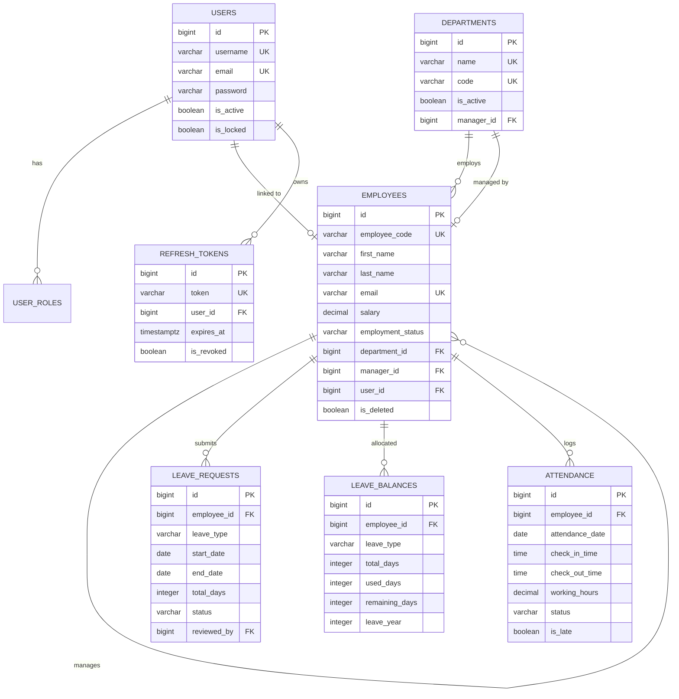

# Enterprise Employee Management System (EMS) 🚀

[](https://www.oracle.com/java/)
[](https://spring.io/projects/spring-boot)
[](https://spring.io/projects/spring-security)
[](https://www.postgresql.org/)
[](https://flywaydb.org/)
[](https://swagger.io/)

A production-grade, secure, and maintainable **Employee Management System** built with **Java 21**, **Spring Boot 3**, **Spring Data JPA**, **Spring Security 6**, and **PostgreSQL**. Designed with clean architecture, strict SOLID principles, immutable Java 21 Records for all DTOs, automated Flyway schema migrations, and interactive Swagger UI documentation with JWT Bearer authentication.

---

## 📋 Table of Contents

1. [Architecture & Design Principles](#-architecture--design-principles)
2. [Technology Stack](#-technology-stack)
3. [System Modules](#-system-modules)
4. [Database Design & Migrations](#-database-design--migrations)
5. [Security & Role-Based Authorization](#-security--role-based-authorization)
6. [Getting Started & Local Setup](#-getting-started--local-setup)
7. [API Documentation & Endpoints](#-api-documentation--endpoints)
8. [Engineering Best Practices & Interview Talking Points](#-engineering-best-practices--interview-talking-points)

---

## 🏛️ Architecture & Design Principles

The application adheres to a clean, **Layered Architecture** with strict separation of concerns:

```
┌────────────────────────────────────────────────────────┐
│                   Client Layer                         │
│        (Frontend / Postman / Swagger UI)               │
└───────────────────────────┬────────────────────────────┘
                            │ HTTP JSON (Bearer JWT)
                            ▼
┌────────────────────────────────────────────────────────┐
│               Security & Filter Layer                  │
│    (JwtAuthenticationFilter, SecurityFilterChain)      │
└───────────────────────────┬────────────────────────────┘
                            │ Authenticated Principal
                            ▼
┌────────────────────────────────────────────────────────┐
│                   Controller Layer                     │
│      (HTTP Request Routing, @Valid DTO Records)        │
└───────────────────────────┬────────────────────────────┘
                            │ Java 21 Request Records
                            ▼
┌────────────────────────────────────────────────────────┐
│                    Service Layer                       │
│    (Business Rules, @Transactional, Quota Engines)     │
└─────────────┬────────────────────────────┬─────────────┘
              │ Entity Mapping             │ JPA Queries
              ▼                            ▼
┌───────────────────────────┐ ┌──────────────────────────┐
│      MapStruct Mappers    │ │     Repository Layer     │
│   (Zero-Reflection DTO ↔  │ │  (Spring Data JPA, JPQL, │
│        Entity Mapping)    │ │   Derived Method Queries)│
└───────────────────────────┘ └────────────┬─────────────┘
                                           │ SQL DDL / DML
                                           ▼
                              ┌──────────────────────────┐
                              │   PostgreSQL Database    │
                              │ (Versioned with Flyway)  │
                              └──────────────────────────┘
```

### Architectural Principles Enforced:
* **Single Responsibility Principle (SRP)**: Controllers strictly route HTTP requests; services encapsulate 100% of business validation and orchestration; repositories isolate persistence.
* **Open/Closed Principle (OCP)**: Services program against interfaces (`EmployeeService`, `DepartmentService`, `LeaveService`, `AttendanceService`, `AuthService`).
* **Dependency Inversion (DIP)**: Strict **constructor-based dependency injection** throughout the application without `@Autowired` on private fields.
* **Immutable Data Carriers (Java 21 Records)**: **100% of all DTOs** (request and response payloads) are implemented using immutable Java 21 Records.
* **Zero Entity Leakage**: JPA Entities are **never** exposed directly to API clients. Mappings are handled at compile time using MapStruct.
* **Safe Soft Deletion**: Employee records use Hibernate `@SQLDelete` and `@Where(clause = "is_deleted = false")` to preserve historical attendance, payroll, and leave data without data corruption.

---

## 💻 Technology Stack

| Layer | Component | Version | Description |
|---|---|---|---|
| **Runtime** | Java | 21 (LTS) | Virtual threads ready, Record DTOs, Pattern Matching |
| **Framework** | Spring Boot | 3.3.5 | Modern core runtime with autoconfiguration |
| **Security** | Spring Security | 6.x | Stateless JWT filter chain & SpEL `@PreAuthorize` |
| **Tokens** | JJWT | 0.12.6 | HMAC-SHA256 signature, claim validation |
| **Persistence**| Spring Data JPA | 3.3.5 | Declarative repositories, Hibernate 6 ORM |
| **Database** | PostgreSQL | 15+ | Relational persistence with indexes & constraints |
| **Migration** | Flyway | 10.x | Reproducible, version-controlled database DDL |
| **Mapping** | MapStruct | 1.6.3 | High-performance compile-time object mapping |
| **Validation**| Jakarta Validation | 3.0 | Hibernate Validator on record components |
| **Docs** | Springdoc OpenAPI | 2.6.0 | Automated OpenAPI 3.0 docs & Swagger UI |
| **Utilities** | Project Lombok | 1.18.36 | `@Getter`, `@Setter`, `@Builder`, `@Slf4j` for entities |

---

## 📦 System Modules

### 1. Authentication & Security Module
- **User Registration & Login**: Validates unique emails and handles; verifies passwords using BCrypt.
- **JWT Token Pair**: Issues short-lived access tokens (24h) and database-backed refresh tokens (7 days).
- **Session Revocation**: `/api/v1/auth/logout` invalidates the active refresh token.
- **RBAC**: Four distinct privilege tiers (`ADMIN`, `HR`, `MANAGER`, `EMPLOYEE`).

### 2. Employee Management Module
- **Full CRUD Operations**: Create, view, update, and soft-delete employees.
- **System-Generated Identifiers**: Formats unique sequential employee codes (`EMP-000001`).
- **Advanced Querying**: Search across `firstName`, `lastName`, and `email`; filter by `department` and `employmentStatus`.
- **Pagination & Sorting**: Universal support for `page`, `size`, `sortBy`, and `sortDir`.
- **Organizational Hierarchy**: Self-referential manager assignment with direct report listing (`/team`).

### 3. Department Management Module
- **Department Administration**: Create, update, soft-disable, and assign managers.
- **Referential Integrity Protection**: Prevents department deletion if active employees are currently assigned.
- **Aggregated Metrics**: Dynamically provides employee headcount for each department.

### 4. Leave Management Module
- **Leave Lifecycle State Machine**: `PENDING` ➔ `APPROVED` or `REJECTED` ➔ `CANCELLED`.
- **Automatic Quota Deduction**: Deducts from `LeaveBalance` upon approval; automatically restores deducted days if an approved leave is subsequently cancelled.
- **Overlap Prevention**: Mathematical query verification: `existing.start <= new.end AND existing.end >= new.start`.
- **Annual Quota Initialization**: HR/Admin endpoint to allocate yearly allowances for `CASUAL`, `SICK`, and `EARNED` leaves.

### 5. Attendance Management Module
- **Daily Check-In/Check-Out**: Automated recording of timestamps.
- **Late Arrival Detection**: Compares check-in time against `09:00 AM` + `15 min grace period`. Times after `09:15 AM` are flagged `late = true`.
- **Duration Calculation**: Accurately computes working hours via `java.time.Duration`.
- **Status Classification Engine**:
  - `< 4.0 hours`: `ABSENT`
  - `4.0 to 8.0 hours`: `HALF_DAY`
  - `>= 8.0 hours`: `PRESENT` (or `LATE` if checked in after grace period)
- **Monthly Summary Analytics**: Computes total days present, late, half-day, absent, accumulated work hours, and daily average.

---

## 🗄️ Database Design & Migrations

Database schema versioning is managed strictly via **Flyway** (`src/main/resources/db/migration`):
- `V1__initial_schema.sql`: Full DDL, constraints, unique keys, and performance indexes.
- `V2__seed_admin_user.sql`: Bootstraps initial administrator credentials (`admin@ems.com` / `Admin@123`).

### Entity Relationship Diagram



---

## 🔒 Security & Role-Based Authorization

| Role | Permissions & Scope |
|---|---|
| **`ADMIN`** | Full administrative privileges: user management, department deletion, manual attendance adjustments, cross-employee leave reviews. |
| **`HR`** | Employee onboarding/updating, department operations, yearly leave quota initialization, attendance reporting. |
| **`MANAGER`** | Team member views, subordinate leave approvals/rejections, attendance inspection. |
| **`EMPLOYEE`** | Profile management, personal leave applications and history, daily check-in/out, personal attendance summaries. |

---

## 🚀 Getting Started & Local Setup

### 1. Prerequisites
- **JDK 21** installed and configured (`java -version`).
- **PostgreSQL** running locally on port `5432`.

### 2. Create PostgreSQL Database
In your `psql` or `pgAdmin` terminal, execute:
```sql
CREATE DATABASE employee_management_db;
```

### 3. Configure Database Credentials
Edit `src/main/resources/application.yml` if your local PostgreSQL username or password differs:
```yaml
spring:
  datasource:
    url: jdbc:postgresql://localhost:5432/employee_management_db
    username: postgres
    password: postgres
```

### 4. Build and Run
Use the included Maven Wrapper:
```cmd
# Clean, compile, and run Flyway migrations
.\mvnw.cmd clean package -DskipTests

# Start the Spring Boot application
.\mvnw.cmd spring-boot:run
```
The server will start on port `8080`.

---

## 📚 API Documentation & Endpoints

### Interactive Swagger UI
Open your browser and navigate to:
```
http://localhost:8080/swagger-ui.html
```

### Default Credentials
| Username / Email | Password | Role |
|---|---|---|
| `admin@ems.com` *(or `admin`)* | `Admin@123` | `ROLE_ADMIN` |

---

### Core Endpoint Reference

#### 1. Authentication (`/api/v1/auth`)
* `POST /api/v1/auth/register` — Register a new account.
* `POST /api/v1/auth/login` — Login with username/email and password to receive JWT tokens.
* `POST /api/v1/auth/refresh` — Exchange refresh token for fresh access token.
* `POST /api/v1/auth/logout` — Revoke active session token.

#### 2. Employees (`/api/v1/employees`)
* `POST /api/v1/employees` — Create an employee record *(Admin/HR)*.
* `GET /api/v1/employees` — Search, filter, and paginate employee directory.
* `GET /api/v1/employees/{id}` — Retrieve employee profile.
* `PUT /api/v1/employees/{id}` — Update employee details.
* `DELETE /api/v1/employees/{id}` — Soft-delete employee *(Admin only)*.
* `GET /api/v1/employees/{id}/team` — View manager's direct reports.

#### 3. Departments (`/api/v1/departments`)
* `POST /api/v1/departments` — Create new department.
* `GET /api/v1/departments` — List active departments (paginated).
* `GET /api/v1/departments/list` — Flat list for UI dropdowns.
* `PUT /api/v1/departments/{id}` — Update department.
* `DELETE /api/v1/departments/{id}` — Soft-delete department (fails if active employees exist).
* `PATCH /api/v1/departments/{id}/manager/{managerId}` — Assign manager.

#### 4. Leave Management (`/api/v1/leaves`)
* `POST /api/v1/leaves` — Apply for leave (validates dates, overlap, and balance).
* `GET /api/v1/leaves` — List all requests *(Admin/HR/Manager)*.
* `GET /api/v1/leaves/my-leaves` — View personal leave history.
* `PATCH /api/v1/leaves/{id}/approve` — Approve request and deduct quota.
* `PATCH /api/v1/leaves/{id}/reject` — Reject request with feedback notes.
* `PATCH /api/v1/leaves/{id}/cancel` — Cancel request (restores quota if previously approved).
* `GET /api/v1/leaves/balances/{employeeId}` — View yearly leave quotas.
* `POST /api/v1/leaves/balances/init` — Allocate annual leave quotas.

#### 5. Attendance Management (`/api/v1/attendance`)
* `POST /api/v1/attendance/check-in` — Check-in for current day (flags late if after 09:15 AM).
* `POST /api/v1/attendance/check-out` — Check-out for current day (calculates working hours).
* `GET /api/v1/attendance/me` — View current day's record.
* `GET /api/v1/attendance/my-history` — Paginated personal attendance log.
* `GET /api/v1/attendance/summary` — Monthly summary report (working hours, present, late, absent).
* `POST /api/v1/attendance/manual` — HR adjustment/entry for past dates.

---

## 💡 Engineering Best Practices & Interview Talking Points

During technical interviews, highlight these deliberate engineering choices:

1. **Why Java 21 Records for DTOs?**
   - Eliminates boilerplate without runtime reflection.
   - Truly immutable data carriers; cannot be altered after creation.
   - Built-in `equals()`, `hashCode()`, and `toString()`.
   - Native integration with Jackson and Jakarta Bean Validation.

2. **Why Normal Classes for JPA Entities?**
   - JPA / Hibernate requires proxy generation, mutable state tracking for dirty-checking, and default no-arg constructors, which Java Records cannot support by specification.

3. **How is the Circular Dependency Handled in Database & ORM?**
   - `Department` references its manager (`Employee`), while `Employee` references their `Department`.
   - Handled cleanly in Flyway using `ALTER TABLE departments ADD CONSTRAINT fk_departments_manager...` after both tables exist.
   - Managed in MapStruct through nested summary records (`ManagerSummary`, `DepartmentSummary`) to eliminate recursive JSON serialization loops.

4. **Why Soft Delete instead of Physical Delete?**
   - In enterprise systems, employee records are tied to historical tax data, attendance records, audit logs, and leave balances. Physical deletion (`DELETE FROM`) causes cascade deletion or FK constraint failures.
   - Hibernate's `@SQLDelete` and `@Where(clause = "is_deleted = false")` cleanly ensure all queries automatically ignore deleted records without modifying existing repository code.

5. **Why Token Rotation with Database Refresh Tokens?**
   - Stateless JWTs cannot be revoked before expiration without a blacklist.
   - By persisting refresh tokens with a UUID and expiration timestamp in PostgreSQL, the server can immediately invalidate sessions on logout, detect token reuse, and enforce revocation.


